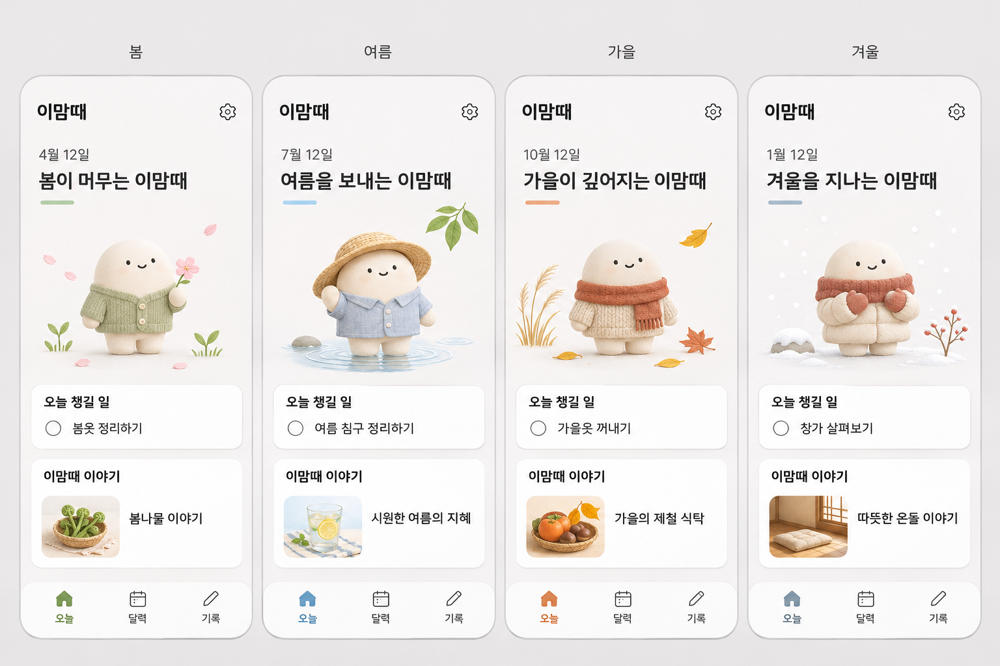

# 이맘때

**지금 챙길 일, 알아둘 것, 기억할 순간.**

계절에 맞는 생활 정보를 내 일정으로 바꾸고, 그날의 기록까지 남기는 개인 캘린더입니다. 흰색 카드와 여백을 중심으로, 중앙의 돌 캐릭터가 사계절의 옷차림과 풍경으로 변합니다. 현재 버전은 **0.2.0**입니다.



[실제 구현된 홈 화면 보기](docs/home-current.png)

## 실행

Node.js 20 이상에서 별도의 패키지 설치 없이 실행합니다.

```sh
npm start
```

브라우저에서 <http://localhost:3000>을 엽니다. 다른 포트는 `PORT` 환경 변수로 지정합니다. 개발 서버는 로컬 기기에서만 접근하도록 설정했습니다. `index.html`을 파일로 직접 열지 말고 서버를 사용하세요.

## 구현한 기능

- **오늘:** 현재 날짜, 사계절 캐릭터, 월별 문구, 할 일 완료·추가·수정·삭제와 완료 현황, 계절 이야기와 일정으로 담기. 할 일 제목을 누르면 내용과 날짜를 수정합니다.
- **달력:** 월 이동, 날짜 선택, 날짜별 일정·기록, 데이터가 있는 날짜 표시.
- **기록:** 날짜와 글 저장·수정, 글자 수 표시, 내용·날짜 검색, 최신 날짜 순 목록, 삭제 확인, 실제 작년 같은 날짜의 기록이 있을 때 홈에서 다시 보기.
- **설정:** 현재 월 자동 테마 또는 12개월 미리보기, JSON 데이터 내려받기와 백업 가져오기.
- **기본 품질:** 모바일·데스크톱 대응, 키보드 포커스, 모션 줄이기 설정, 사용자 입력 HTML 이스케이프.

일정과 기록은 **현재 브라우저의 localStorage**에 저장됩니다. 계정·서버 동기화가 없으며 브라우저 데이터 삭제 시 사라집니다. 설정에서 백업을 내려받고 다른 브라우저에서 가져올 수 있습니다.

백업 가져오기는 10MB 이하의 버전 1 JSON 파일을 지원하며, 이전 0.1.0에서 내려받은 백업도 사용할 수 있습니다. 복원 전 추가할 항목 수를 확인하고 동의한 경우만 적용합니다. 현재 데이터와 테마 설정은 유지하고 새 ID의 항목만 추가합니다. 같은 ID의 수정 이력은 현재 항목을 우선하며, 다른 기기에서 별도로 만든 항목은 내용이 같아도 추가될 수 있습니다. 잘못된 파일이나 저장 실패 시 복원은 적용되지 않습니다.

사계절 이미지 4종과 월별 문구 12종을 제공합니다. 월별로 다른 옷 12종, 실시간 날씨·위치, 푸시 알림, 사진 첨부, 앱스토어 배포는 아직 구현하지 않았습니다. 현재 제공물은 **실행 가능한 웹앱 첫 버전**입니다.

## 검사

```sh
npm run check
npm test
npm run test:browser
```

브라우저 검사는 Node.js 22 이상(기본 검증 환경: 24)과 로컬 Chrome을 사용합니다. 기본 경로는 Windows의 `C:/Program Files/Google/Chrome/Application/chrome.exe`입니다. 다른 환경에서는 `CHROME_PATH`를 지정하세요. 스크린샷과 테스트 전용 Chrome 프로필은 Git에서 제외되는 `test-results/`에 저장합니다. 테스트는 격리된 임시 서버·브라우저 프로필에서 실행되어 실제 사용자 데이터와 분리됩니다.

## 문서

- [개발 시 반드시 지킬 사항](AGENTS.md)
- [브랜드·UI 원칙](docs/DESIGN.md)
- [구현 범위·출시 전 과제](docs/DEVELOPMENT.md)
- [생성 이미지와 프롬프트](docs/ASSETS.md)

정적 파일은 `index.html`, `styles.css`, `app.js`, `data.js`, `assets/`로 구성됩니다. 저장소 전체를 웹 루트로 공개하지 마세요. 동봉한 서버는 허용된 앱 파일만 제공합니다.
