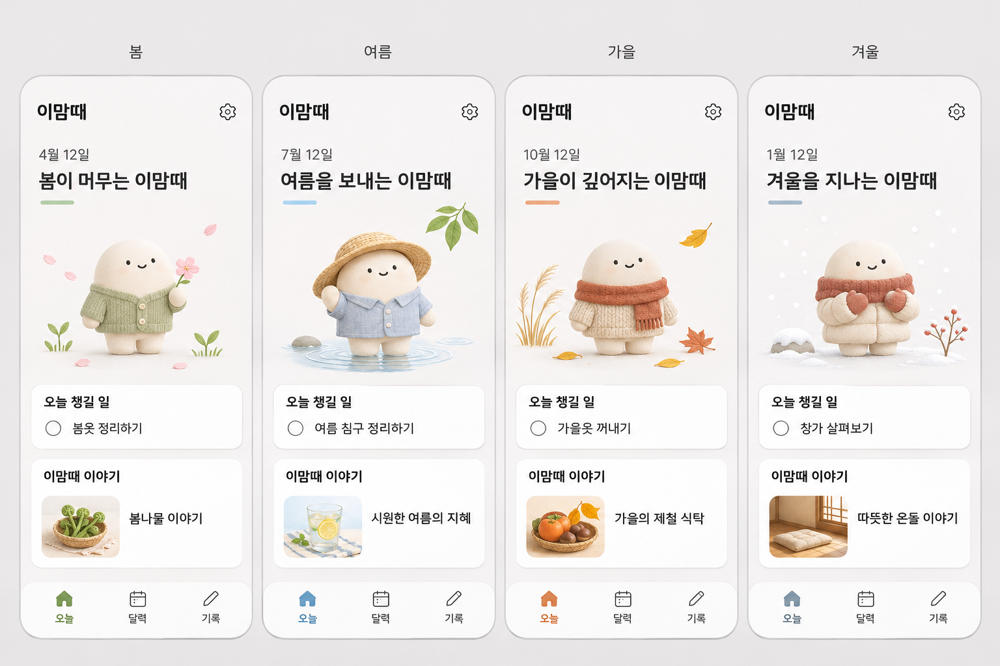

# 브랜드와 화면 원칙

## 합의한 방향

“계절에 맞는 생활 정보를 내 일정으로 바꾸고, 그날의 기록까지 남기는 개인 캘린더.”

단정한 흰색 UI와 중앙 캐릭터를 중심으로 한다. 같은 캐릭터가 계절을 함께 보내는 경험을 만든다. 캐릭터는 둥근 흰 돌 형태, 작은 눈과 입, 짧은 팔다리, 따뜻하고 부드러운 재질이다.

## 화면 구성

1. 상단: 이맘때 로고와 설정.
2. 오늘: 날짜와 계절 제목 → 중앙 캐릭터 → 오늘 챙길 일 → 계절 이야기 → 기록 진입.
3. 달력: 월별 날짜 → 선택한 날짜의 할 일과 기록.
4. 기록: 내가 남긴 글, 새 기록 작성.
5. 하단 고정 내비게이션: 오늘·달력·기록.

홈의 정보량은 적게 유지한다. 세부 내용은 사용자가 카드를 열어 볼 때 제공한다. 빈 기록에는 가짜 추억을 채우지 않고 첫 기록 작성을 안내한다.

0.2.0에서는 할 일 제목을 편집 진입점으로 사용하고 기록 카드에 작은 연필 버튼을 배치했다. 완료 현황은 얇은 선으로 표시한다. 기록 검색은 기록 화면에, 백업 복원은 설정 안에 두어 홈의 정보량을 늘리지 않는다.

## 계절 규칙

| 계절 | 월 | 옷차림·풍경 | 포인트 |
|---|---|---|---|
| 봄 | 3~5월 | 연두 카디건, 작은 꽃, 새싹과 꽃잎 | 세이지 |
| 여름 | 6~8월 | 하늘색 셔츠, 밀짚모자, 잎과 물결 | 하늘색 |
| 가을 | 9~11월 | 니트와 스카프, 억새와 낙엽 | 살구·갈색 |
| 겨울 | 12~2월 | 크림색 패딩, 목도리와 장갑, 눈 | 회청색 |

현재는 사계절 의상 4종에 월별 문구를 조합한다. 이후 12개월 의상·소품을 제작할 때도 같은 캐릭터 정체성을 유지한다. 날씨 연동이 생기면 우산·바람 등 작은 반응으로 확장한다.

## 시각 기준

- 배경 `#f8f9f7`, 카드 `#ffffff`, 본문 `#30342e`.
- 시스템 한글 글꼴로 외부 폰트 요청 없이 표시한다.
- 얇은 테두리와 약한 그림자, 둥근 카드, 작은 선형 아이콘.
- 기본 터치 영역과 명확한 포커스 표시를 유지한다.
- 월별 미리보기의 날짜는 실제 오늘 그대로 두고 미리보기임을 표시한다.

